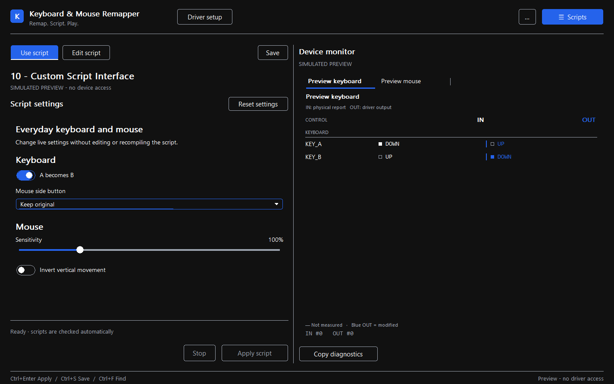

# Keyboard & Mouse Remapper - Windows Remapping, Scripts and Macros

A native **C++17 Windows application** for keyboard and mouse remapping, timed
macros and editable **.igc scripts**. Built with the
[Interceptor Keyboard & Mouse kernel filter driver](https://github.com/TitanCSA/Interceptor-Keyboard-Mouse),
using the same interface and scripting engine as
[GamePad Remapper](https://github.com/TitanCSA/GamePad-Remapper).

Use it as a ready-to-run tool or study it as a complete example of the driver's
keyboard/mouse SDK.

**[Download](https://github.com/TitanCSA/Keyboard-Mouse-Remapper/releases/latest)** |
[Language](docs/LANGUAGE.md) | [Script settings](docs/SCRIPT-INTERFACE.md) |
[Build](docs/BUILD.md) | [Validation](docs/VALIDATION.md)



Screenshots use explicitly simulated input. Normal operation displays captured
physical strokes and successfully accepted driver output.

## Install and start

Requires **Windows 10 1709+ / Windows 11 x64** and administrator rights for live input.
The app is a standalone native EXE; no .NET runtime or application DLL is needed.

1. Extract the **Keyboard-Mouse-Remapper-1.0.0-win-x64.zip** release.
2. Run **InterceptorSetup.exe**, choose **Install / reinstall**, and restart
   Windows if requested. Reopen setup to complete any pending associations.
3. Open **KeyboardMouseRemapper.exe** and accept UAC. Live IN/OUT observation
   starts automatically in passthrough.
4. Open **Scripts**, choose an example, adjust its settings and select
   **Apply script** or press **Ctrl+Enter**.
5. **Stop** removes the script and restores physical input. Observation continues.
   Close the application to release capture completely.

**The driver demo allows one hour per Windows boot. Observation starts a capture,
so the allowance starts when this application opens normally**, even with no script.
The allowance is shared with other apps using this driver edition. Restart Windows
for another allowance. For the unrestricted driver, DM **titancsa** on Discord.

Close other keyboard/mouse capture applications before starting. Physical
**Ctrl+Alt+Delete** revokes capture; the app stays suspended until an explicit Apply
or restart. If the app exits unexpectedly, the driver closes its capture and
restores passthrough. Uninstall through the included driver's setup.
[Driver installation and recovery](https://github.com/TitanCSA/Interceptor-Keyboard-Mouse/blob/main/docs/INSTALLATION.md).

## Use scripts or edit them

| Workspace | Purpose |
| --- | --- |
| **Use script** | Adjust sliders, switches, dropdowns and numeric settings |
| **Edit script** | Write code or edit visual remaps, conditions and macro steps |

Both views use the same file. Custom code is preserved when switching views;
arbitrary code remains advanced code rather than being falsely presented as a
complete visual graph. Settings are saved separately from the script.
**Ctrl+S** saves; **Ctrl+F** searches code. Scripts normally live under
`Documents/Keyboard & Mouse Remapper/Scripts`.

```c
ui {
    title("My keyboard and mouse");
    toggle enabled("A becomes B", true);
    slider speed("Mouse sensitivity", 10, 300, 100, "%");
    toggle invert_y("Invert mouse Y", false);
}
main {
    if (enabled) remap(KEY_A, KEY_B);
    sensitivity(MOUSE_X, speed);
    sensitivity(MOUSE_Y, speed);
    if (invert_y) invert(MOUSE_Y);
}
```

Physical B remains usable when A is remapped to B. Mouse sensitivity uses raw
movement counts, preserves fractional scaling and does not clamp movement to
gamepad percentages. Keyboard and mouse share one combined script frame, allowing
chords such as **Ctrl + right mouse button**, timed sequences and cross-family remaps.

**Key names describe physical US scan-code positions**, not characters typed in
every keyboard layout. Extended keys stay distinct. Raw `SCAN_1E`, `E0_1D` and
`E1_45` identifiers support other scan-code positions. See [controls](docs/LANGUAGE.md).

## Live IN / OUT

Select a keyboard or mouse tab to inspect its own input and output. Rows keep
stable positions, and blue OUT values identify changes. The latest fields remain
visible without a loaded script.

- **IN**: the original stroke delivered to the capture API.
- **OUT**: a stroke successfully accepted by the driver's send operation.
- A dash means no measurement. OUT does not prove that every application consumed
  an event, and IN/OUT timestamps are not an end-to-end latency measurement.

Scripts can send a keyboard control through an available keyboard endpoint and a
mouse control through an available mouse endpoint. A cross-family remap therefore
needs both device types. Physical source tokens and actual output endpoints remain
separate in the inspector. Input is not saved to disk automatically; **Copy
diagnostics** explicitly copies the current measurements.

## Included examples

Key remapping, mouse sensitivity/inversion, timed typing, toggled holds,
mouse-to-keyboard mapping, functions/tables, additive figure-eight movement,
wheel changes, combined triggers, and a complete script-defined interface.
[Browse the scripts](Scripts).

The language has variables, arrays, functions, bounded loops, events and timed
`combo` sequences. Scripts cannot open files, access a network or execute OS
commands. IGC is an independent language inspired by GPC; existing Cronus scripts
are not guaranteed to compile unchanged.

## Source and build

```text
App/          Native C++ app, interface, compiler, capture engine and tests
Scripts/      Editable .igc examples
docs/         Usage, language, build and validation
Interceptor/  Original two-file Keyboard/Mouse C++ SDK
```

Build with `powershell -ExecutionPolicy Bypass -File .\Build.ps1`.
The build runs offline tests and does not install or capture on the build computer.
[Build instructions](docs/BUILD.md). `--demo`, `--check-script file.igc` and
offline interface tests work without the driver or elevation.

The application and SDK sources use the MIT license. The supplied Microsoft-signed
driver has [separate demo terms](DRIVER-BINARY-LICENSE.txt). Microsoft's signature
covers the driver package, not this application's EXE.

## Responsible use and disclaimer

This project, including its drivers, SDKs, libraries, applications, installers and examples, was created for lawful, constructive purposes such as accessibility, device customization, research, testing and software development. Illegal, malicious or unauthorized use is neither intended nor endorsed by TitanCSA or the contributors.

You are solely responsible for how you use, modify or distribute the software, for obtaining any necessary authorization, and for complying with applicable laws, third-party rights and service rules. TitanCSA and the contributors do not accept responsibility for users' actions, including illegal activity or misuse of the drivers or SDKs.

To the maximum extent permitted by applicable law, the software is provided "AS IS", without warranties of any kind, and TitanCSA and the contributors are not liable for claims, damages, data loss, system damage or other consequences arising from its use or misuse. Nothing in this notice excludes liability that cannot legally be excluded. Existing project and third-party license terms remain applicable.
